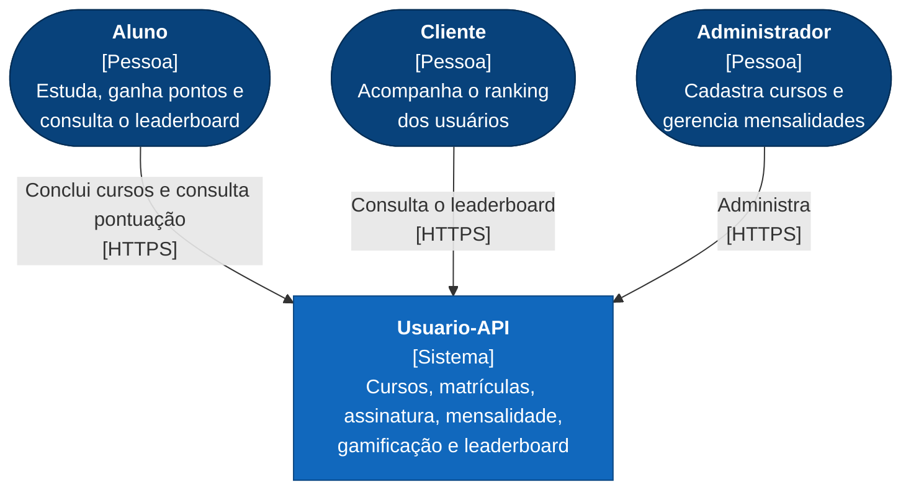
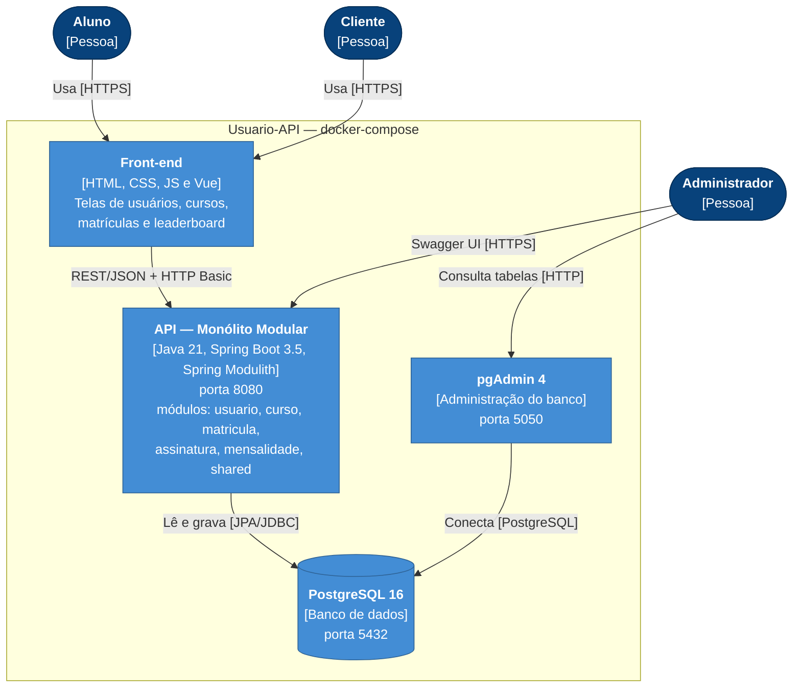
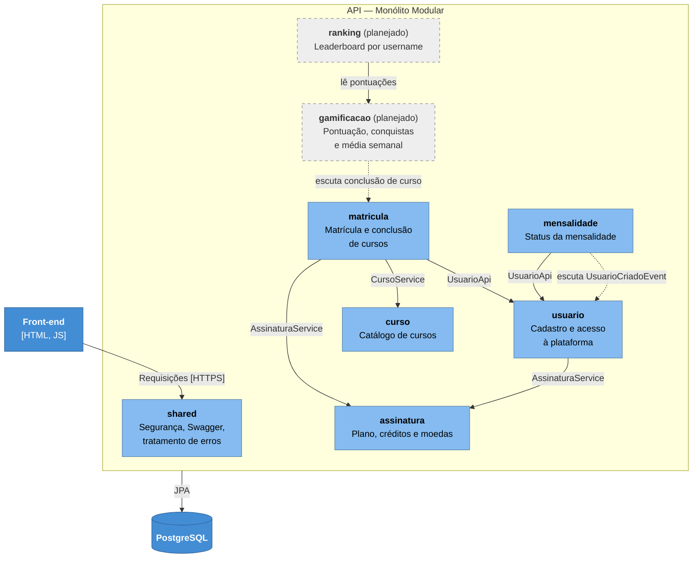
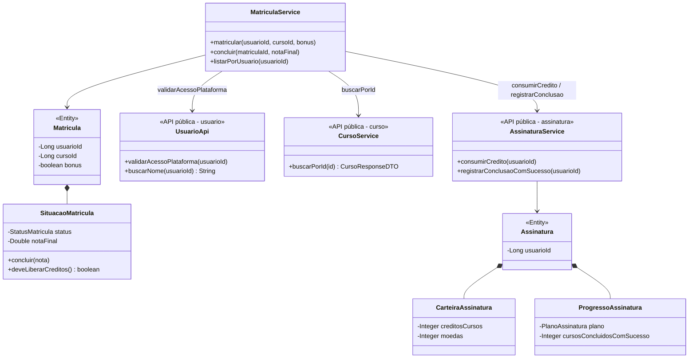
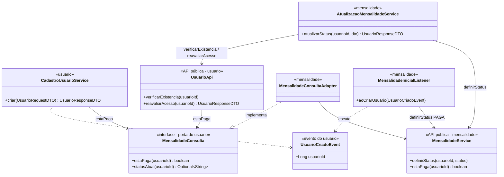
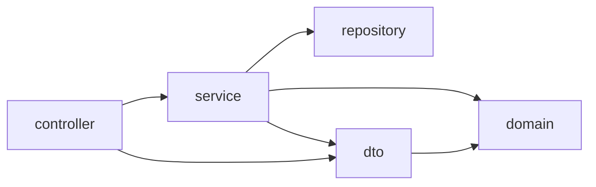
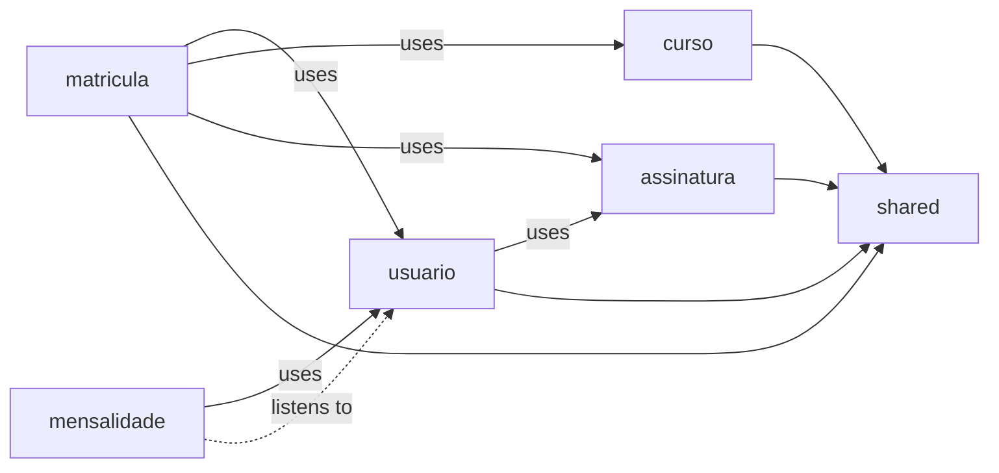

# Usuario-API — README arquitetural

## Estudo de Caso — Educação Continuada Gamificada

Evolução do projeto legado da AC1 — uma API Spring Boot (Java 21, PostgreSQL, Docker) com usuários, cursos, matrículas, assinatura com créditos e mensalidade — para receber **leaderboard** e **gamificação dos estudos**.

> Instruções de execução (Docker, profiles, pgAdmin) estão no [README.md](README.md).

**Sumário:**
1. [RF](#1--rf)
2. [RNF](#2--rnfs)
3. [ASR](#3--asrs)
4. [RPC](#4--rpc)
5. [Alternativas](#5--alternativas-e-trade-offs)
6. [Decisão](#6--decisão-do-techlead)
7. [ADR-001](#7--adr-001)
8. [C4](#8--c4)
9. [Mini-lab](#9--mini-lab--evidência-arquitetural)
10. [Evidências versionadas](#10--evidências-versionadas-no-git)
11. [Conclusão](#11--conclusão)

---

## 1 – RF

| ID | Requisito Funcional | User Story | RN |
|---|---|---|---|
| 1 | Leaderboard dos alunos | **COMO** Cliente **QUERO** ter um ranking para meus usuários **PARA** ter uma métrica de meus usuários. | RN1: Deve mostrar o username dos usuários na leaderboard. |
| 2 | Gamificação dos estudos | **COMO** Aluno **QUERO** sentir que conquistei algo **PARA** ter mais motivação. | RN1: Fazer uma média semanal dos usuários. |

---

## 2 – RNF's

| Requisito Funcional | ID | Categoria FURPS+ | Requisito Não Funcional |
|---|---|---|---|
| Leaderboard dos alunos | **1.1** | **U – Usabilidade** | O leaderboard deve apresentar os usuários de forma **clara, organizada e fácil de compreender**. |
| Leaderboard dos alunos | **1.2** | **P – Escalabilidade** | O leaderboard deve **suportar o crescimento da base de alunos (até 100 mil usuários)** sem prejudicar a exibição do ranking. |
| Leaderboard dos alunos | **1.3** | **S – Segurança** | O sistema deve garantir que somente **dados autorizados dos usuários** sejam exibidos no leaderboard. |
| Gamificação dos estudos | **2.1** | **U – Usabilidade** | Os elementos de gamificação devem ser apresentados de forma **intuitiva e fácil de entender**. |
| Gamificação dos estudos | **2.2** | **R – Confiabilidade** | O sistema deve **manter corretamente as pontuações e conquistas**, evitando perda ou alteração indevida dos dados. |
| Gamificação dos estudos | **2.3** | **M – Manutenibilidade** | As regras de gamificação e do leaderboard devem ficar **isoladas em módulos próprios**, permitindo alterá-las sem impactar o restante do sistema. |

---

## 3 – ASR's

Requisitos não funcionais que definem a arquitetura:

1. **RNF 1.2** — Leaderboard suportando o crescimento da base de alunos (até 100 mil usuários).
2. **RNF 2.2** — Pontuações e conquistas mantidas corretamente, sem perda ou alteração indevida.
3. **RNF 2.3** — Regras de gamificação e do leaderboard isoladas em módulos próprios.

---

## 4 – RPC

| ASR | Ponto de atenção na arquitetura |
|---|---|
| RNF 1.2 — Escalabilidade | Com muitos alunos, ordenar toda a base a cada acesso fica pesado; a consulta do ranking precisa ser paginada e indexada no banco. |
| RNF 2.2 — Confiabilidade | A pontuação deve ser atualizada junto com a conclusão do curso, na mesma transação, para não perder nem duplicar pontos. |
| RNF 2.3 — Manutenibilidade | Leaderboard e gamificação devem ser módulos separados, com fronteiras claras, para que mudanças nas regras não afetem o resto do sistema. |

---

## 5 – Alternativas e Trade-off's

| Alternativa | Vantagens | Desvantagens |
|---|---|---|
| **Monólito modular** (escolhida) | Transação única garante o RNF 2.2; módulos isolados atendem o RNF 2.3; aproveita o código da AC1. | Exige disciplina para não acoplar os módulos; para atender o RNF 1.2 é preciso escalar a aplicação inteira. |
| Monólito em camadas (legado) | Já existe e é simples. | O leaderboard fica acoplado às demais camadas e não pode evoluir nem ser extraído separadamente (prejudica o RNF 1.2); as regras de gamificação ficam misturadas com o resto do código (prejudica o RNF 2.3). |
| Microsserviço de ranking | Isola o leaderboard e permite escalá-lo separadamente (RNF 1.2). | Dados divididos entre serviços dificultam o RNF 2.2; mais infraestrutura para manter. |

---

## 6 – Decisão do TechLead

Adotar a arquitetura de **Monólito Modular**: um único sistema dividido em módulos por capacidade de negócio, com o leaderboard e a gamificação como módulos próprios dentro da Usuario-API e o mesmo banco PostgreSQL.

- **RNF 2.2:** a pontuação fica confiável porque é gravada na mesma transação da conclusão do curso.
- **RNF 2.3:** as regras ficam isoladas, e as fronteiras são verificadas automaticamente pelo Spring Modulith.
- **RNF 1.2:** o crescimento da base é atendido com consulta paginada e indexada e, se necessário, mais instâncias da aplicação.

---

## 7 – ADR-001

Registro completo, com contexto, decisão, alternativas, trade-offs e critério para revisitar: **[docs/adr/ADR-001-monolito-modular.md](docs/adr/ADR-001-monolito-modular.md)**.

Resumo dos trade-offs:

| Ganhamos | Pagamos |
|---|---|
| Uma transação para pontuação + conclusão (RNF 2.2) | A aplicação escala como um todo (RNF 1.2 depende de paginação/índice e réplicas) |
| Fronteiras explícitas e testadas no build (RNF 2.3) | Sem joins JPA entre módulos: dados de outro módulo vêm pela API pública |
| Um deploy e um banco: pouca infraestrutura | Mais classes de "cola" (portas, adapters, eventos) |
| Módulo pronto para virar serviço, se as medições justificarem | Exige aprender as regras de visibilidade (`internal`, `@NamedInterface`) |

---

## 8 – C4

### 8.1 Nível 1 — Contexto



### 8.2 Nível 2 — Contêineres (atualizado)

Reflete o `docker-compose.yml` e a branch `refactor/monolito-modular`. A API continua sendo **um único contêiner**: a modularização é interna e não cria novos processos.



| Contêiner | Tecnologia | Responsabilidade |
|---|---|---|
| Front-end | Páginas estáticas servidas pela própria API (`/index.html`) e versão Vue | Interface para aluno, cliente e admin |
| API - Monólito Modular | Spring Boot 3.5 + Spring Modulith 1.4 | Regras de negócio, divididas em módulos com fronteiras verificadas |
| PostgreSQL 16 | Banco relacional | Persistência; tabelas `usuarios`, `cursos`, `matriculas`, `assinaturas`, `mensalidades` |
| pgAdmin 4 | Ferramenta de administração | Inspeção do banco em desenvolvimento |

### 8.3 Nível 3 — Componentes (módulos da API)

Linha cheia = chamada à API pública; linha tracejada = evento. Módulos com borda tracejada estão planejados.



### 8.4 Nível 4 — Código

Classes reais da branch [`refactor/monolito-modular`](https://github.com/lfmutton/devOpsClass-task2/tree/refactor/monolito-modular). Cada pacote é um módulo (verificado com **Spring Modulith**): as classes na raiz do pacote são a **API pública** do módulo e as do subpacote `internal` só podem ser usadas dentro dele. Os módulos se referenciam apenas por `usuarioId`/`cursoId`, sem relacionamento JPA entre si.

O diagrama foi dividido em dois fluxos para ficar legível.

**a) Matrícula e conclusão de curso** (`matricula` → `usuario`, `curso`, `assinatura`)



**b) Usuário × mensalidade sem ciclo** (inversão de dependência com porta + evento)



- **Fluxo da conclusão de curso:** `MatriculaService.concluir()` valida o acesso pela `UsuarioApi`, conclui a `SituacaoMatricula` e, se a nota for ≥ 7, chama `AssinaturaService.registrarConclusaoComSucesso()`. Tudo na mesma transação, o que garante o **RNF 2.2**.
- **Fronteiras entre módulos:** a `matricula` só enxerga a API pública dos outros módulos (`UsuarioApi`, `CursoService`, `AssinaturaService`), nunca as entidades ou repositórios `internal`. É isso que atende o **RNF 2.3**.
- **Usuário × mensalidade sem ciclo:** o `usuario` não conhece o módulo `mensalidade`. Ele declara a porta `MensalidadeConsulta` e publica `UsuarioCriadoEvent`. O módulo `mensalidade` implementa a porta (`MensalidadeConsultaAdapter`), escuta o evento (`MensalidadeInicialListener`, na mesma transação) e usa a `UsuarioApi` no endpoint `PUT /api/usuarios/{id}/mensalidade`.
- O módulo `shared` (configuração de segurança, Swagger, tratamento de erros e `RecursoNaoEncontradoException`) foi omitido do diagrama por ser infraestrutura comum.

---

## 9 – Mini-lab — evidência arquitetural

**Hipótese:** a modularização torna as fronteiras e as dependências entre capacidades de negócio **mais explícitas**, sem alterar o comportamento da API.

**Método:** a mesma ferramenta foi executada sobre os dois códigos:

- **Antes:** branch `main` (commit `ff23035`), em camadas.
- **Depois:** branch `refactor/monolito-modular` (commit `466fa6a`).
- **Ferramenta:** **Spring Modulith 1.4.3**, com `ApplicationModules.of(...)`, `verify()` e `Documenter`.

O Spring Modulith considera cada subpacote de `com.exemplo.usuario` um módulo, lê as dependências reais do bytecode e reprova ciclos e acessos a tipos internos de outro módulo. Também rodamos `mvn clean test` nas duas versões.

A capacidade modularizada é a **própria AC1** (usuário, curso, matrícula, assinatura e mensalidade), como permite o item 10. O ranking e a gamificação seguirão o mesmo molde (`ranking/` e `gamificacao/`, com API pública na raiz e `internal/`).

Os arquivos brutos estão em [`docs/evidencias/`](docs/evidencias).

### 9.1 Estrutura antes — por camada técnica

Arquivo completo: [docs/evidencias/antes/estrutura.txt](docs/evidencias/antes/estrutura.txt).

```
com.exemplo.usuario/
├── config/        OpenApiConfig, SecurityConfig
├── controller/    CursoRestController, MatriculaRestController, MensalidadeRestController,
│                  UsuarioRestController, HomeController, ApiExceptionHandler
├── domain/        Usuario, Curso, Matricula, Assinatura, Mensalidade, ... (13 classes)
│   └── vo/        EmailUsuario, NomeUsuario, TituloCurso, ... (7 classes)
├── dto/           12 DTOs de todas as capacidades, misturados
├── repository/    5 repositories
└── service/       CursoService, MatriculaService, MensalidadeService, UsuarioService
```

### 9.2 Estrutura depois — por capacidade de negócio

Arquivo completo: [docs/evidencias/depois/estrutura.txt](docs/evidencias/depois/estrutura.txt).

```
com.exemplo.usuario/
├── usuario/                         ← módulo
│   ├── UsuarioApi.java              ← API pública (contrato)
│   ├── MensalidadeConsulta.java     ← porta (contrato implementado por outro módulo)
│   ├── UsuarioCriadoEvent.java      ← evento publicado
│   ├── dto/                         ← exposto (@NamedInterface)
│   └── internal/                    ← privado
│       ├── controller/  UsuarioRestController
│       ├── domain/      Usuario, PerfilUsuario, AcessoPlataforma, EmailUsuario, ...
│       ├── dto/         UsuarioRequestDTO
│       ├── repository/  UsuarioRepository
│       └── service/     CadastroUsuarioService, ConsultaUsuarioService, UsuarioResponseMapper
├── curso/         CursoService + dto/ + internal/{controller,domain,repository}
├── matricula/     internal/{controller,domain,dto,repository,service}   (ninguém depende dela)
├── assinatura/    AssinaturaService + dto/ + internal/{domain,repository}
├── mensalidade/   MensalidadeService, StatusMensalidade + internal/{controller,domain,dto,repository,service}
└── shared/        RecursoNaoEncontradoException, Texto, config/, controller/
```

Em relação ao exemplo do enunciado (`api/` + `internal/`), a API pública fica na **raiz** do pacote do módulo, que é a convenção padrão do Spring Modulith. O papel é o mesmo: o que está fora de `internal/` é o contrato.

### 9.3 Dependências — antes × depois

**Antes:** o Spring Modulith só consegue enxergar **camadas**. O grafo gerado ([antes/components.puml](docs/evidencias/antes/components.puml)) não mostra nenhuma capacidade de negócio:



Para descobrir quem depende de quem entre capacidades, é preciso abrir os imports de cada classe:

| Classe (antes) | Capacidades que ela toca |
|---|---|
| `UsuarioService` | usuário, **mensalidade** |
| `MensalidadeService` | mensalidade, **usuário** ← ciclo com a linha de cima |
| `MatriculaService` | matrícula, **usuário, curso, assinatura**, usando direto os 4 repositories |
| Entidades `domain/` | 6 relações JPA cruzando capacidades: `Usuario↔Assinatura`, `Usuario→Mensalidade` (via `AcessoPlataforma`), `Mensalidade→Usuario`, `Matricula→Usuario`, `Matricula→Curso` |

`verify()` antes ([antes/verify.txt](docs/evidencias/antes/verify.txt)): **FALHOU com 2 violações**, `service` usando o tipo interno `domain.vo.EmailUsuario`.

**Depois:** o grafo gerado ([depois/components.puml](docs/evidencias/depois/components.puml)) mostra as **capacidades** e o **tipo** de cada dependência:



`verify()` depois ([depois/verify.txt](docs/evidencias/depois/verify.txt)): **OK, nenhuma violação e nenhum ciclo**. Os contratos de cada módulo aparecem em [depois/modulos.txt](docs/evidencias/depois/modulos.txt), em "Named interfaces".

O ciclo `usuário ⇄ mensalidade` foi quebrado por **inversão de dependência**: o `usuario` define a porta `MensalidadeConsulta` e publica `UsuarioCriadoEvent`, e o `mensalidade` implementa a porta e escuta o evento (na mesma transação).

### 9.4 O que comparar — resultado

| Evidência | Antes (`main`) | Depois (`refactor/monolito-modular`) | Resultado esperado atingido? |
|---|---|---|---|
| **Organização** | 6 pacotes por camada técnica (`controller`, `service`, `repository`, `domain`, `dto`, `config`) | 6 módulos por capacidade (`usuario`, `curso`, `matricula`, `assinatura`, `mensalidade` + `shared`) | ✅ Por capacidade de negócio |
| **Dependências** | Capacidades misturadas nas mesmas camadas; ciclo `UsuarioService ⇄ MensalidadeService`; 6 relações JPA entre capacidades; 2 violações no `verify()` | Grafo explícito e unidirecional; 0 ciclos; 0 relações JPA entre módulos (só `usuarioId`/`cursoId`); 0 violações; acesso só por contratos (`UsuarioApi`, `CursoService`, `AssinaturaService`, `MensalidadeService`, `MensalidadeConsulta`, `UsuarioCriadoEvent`) | ✅ Explícitas e por contratos definidos |
| **Testes** | 10 classes de teste em pastas por camada (`domain/`, `service/`, `dto/`, `repository/`) | 26 classes de teste espelhando os módulos: usuario 34, matricula 21, mensalidade 19, curso 16, assinatura 16, shared 4, mais `ModularidadeTest` e `CadastroEMensalidadeIntegracaoTest` | ✅ Concentrados por módulo |
| **Evolução futura** | Extrair uma capacidade exige caçar classes em 5 pastas e desfazer relações JPA | Cada módulo já tem API, persistência e testes próprios, sem FK em código para outro módulo | ✅ Fronteira clara para extração futura |

### 9.5 Testes executados — preservação do comportamento

Saída completa: [antes/testes.txt](docs/evidencias/antes/testes.txt) e [depois/testes.txt](docs/evidencias/depois/testes.txt).

| `mvn clean test` | Testes | Falhas | Erros | Resultado |
|---|---|---|---|---|
| Antes (`main`, `ff23035`) | 63 | 0 | 0 | BUILD SUCCESS |
| Depois (`refactor/monolito-modular`, `466fa6a`) | **114** | **0** | **0** | **BUILD SUCCESS** |

- Os cenários da `main` foram migrados para os novos pacotes sem mudar o que verificam (regras de matrícula, créditos, mensalidade, value objects, JSON e mapeamento JPA).
- Testes novos:
  - `ModularidadeTest`: a **arquitetura** em si (fronteiras e ciclos).
  - `CadastroEMensalidadeIntegracaoTest`: integração com Spring e H2, cobrindo o evento entre os módulos `usuario` e `mensalidade`.
  - Testes dos novos serviços, adapters e listeners.
- **Contrato externo inalterado:** mesmas URLs e mesmo JSON (os DTOs usam `@JsonUnwrapped` para manter o formato plano), o front-end não precisou mudar, e a imagem Docker com PostgreSQL 16 subiu e respondeu normalmente.
- **Complexidade ciclomática (JaCoCo):** 55 classes, nenhuma acima de 7.

---

## 10 – Evidências versionadas no Git

| Item pedido | Onde está |
|---|---|
| README arquitetural com RF → RNF → ASR → RPC → alternativas → decisão | Este arquivo, seções 1 a 6 |
| ADR-001 com decisão e trade-offs | [docs/adr/ADR-001-monolito-modular.md](docs/adr/ADR-001-monolito-modular.md) |
| C4 Container atualizado | [Seção 8.2](#82-nível-2--contêineres-atualizado) |
| Código da modularização (funcionalidade da AC1) | Pacotes `src/main/java/com/exemplo/usuario/{usuario,curso,matricula,assinatura,mensalidade,shared}`, nos commits `6731d2b`, `d547466` e `466fa6a` desta branch |
| Evidência antes/depois das dependências e da estrutura | [Seção 9](#9--mini-lab--evidência-arquitetural) e [docs/evidencias/](docs/evidencias) (`estrutura.txt`, `modulos.txt`, `verify.txt`, `components.puml`) |
| Testes executados após a refatoração | [Seção 9.5](#95-testes-executados--preservação-do-comportamento) e `docs/evidencias/*/testes.txt`; a verificação contínua fica em `src/test/java/com/exemplo/usuario/ModularidadeTest.java` |
| Breve conclusão | [Seção 11](#11--conclusão) |

**Como reproduzir:**

```bash
mvn clean test
```

O `ModularidadeTest` reprova o build se alguma fronteira for violada e gera o grafo atualizado em `target/spring-modulith-docs/`.

